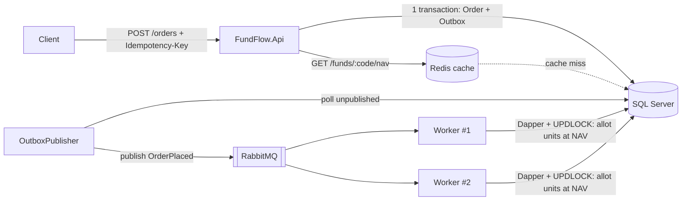

# FundFlow — ระบบรับคำสั่งซื้อ-ขายหน่วยลงทุนแบบ event-driven

โปรเจกต์ตัวอย่างสำหรับเตรียมสมัครตำแหน่ง Senior .NET Developer
ครอบคลุม stack ที่ประกาศงานต้องการ: **C# / .NET 10, REST API, RabbitMQ, Redis, SQL Server (EF Core + Dapper), Docker, CI/CD, unit test**

โจทย์ตั้งใจเลือกให้ใกล้กับงาน AMC Registrar ที่ทำอยู่ เพื่อให้เล่าตอนสัมภาษณ์ได้จากประสบการณ์จริง

---

## สถาปัตยกรรม



| ส่วน | หน้าที่ | เทคนิคที่โชว์ได้ |
|---|---|---|
| `FundFlow.Core` | Domain model, คำนวณหน่วย, validation | ตรรกะธุรกิจแยกจาก infrastructure, test ได้โดยไม่ต้องมี DB |
| `FundFlow.Api` | รับคำสั่ง, ดู NAV | Minimal API, EF Core, **idempotency key**, **transactional outbox**, Redis **cache-aside** |
| `FundFlow.Worker` | ประมวลผลคำสั่งจากคิว | RabbitMQ consumer (manual ack, prefetch), **Dapper**, **idempotent consumer** ด้วย row lock |
| `FundFlow.Tests` | unit test | xUnit, test กรณีปัดเศษที่ผิดง่าย |
| `docker-compose.yml` | รันทั้งระบบ | multi-container, worker 2 ตัวพร้อมกัน |
| `.github/workflows/ci.yml` | CI | build → test → build Docker image |

---

## วิธีรัน

ต้องมี [.NET 10 SDK](https://dotnet.microsoft.com/download) และ Docker Desktop

```bash
# รันทั้งระบบ (SQL Server, RabbitMQ, Redis, API, Worker x2)
docker compose up --build

# รัน unit test
dotnet test FundFlow.slnx
```

จากนั้นเปิด `requests.http` ใน VS Code (ส่วนขยาย REST Client) หรือ Rider แล้วยิงทีละ request

- API: http://localhost:8080
- RabbitMQ UI: http://localhost:15672 (guest / guest)

ถ้าต้องการ debug API ใน IDE: รันแค่ `docker compose up sqlserver rabbitmq redis` แล้วกด F5 ที่ FundFlow.Api และ FundFlow.Worker (`appsettings.json` ชี้ localhost ไว้แล้ว)

### สิ่งที่ควรลองเพื่อเห็นแต่ละ concept

1. **Cache:** เรียก `GET /funds/FF-EQUITY/nav` สองครั้ง ครั้งที่สอง `fromCache: true`
2. **Idempotency:** ส่ง `POST /orders` ซ้ำด้วย `Idempotency-Key` เดิม จะได้คำสั่งเดิมกลับมา ไม่สร้างซ้ำ
3. **Async processing:** หลัง POST สถานะเป็น `Pending` รอสัก 2–3 วินาทีแล้ว GET จะเป็น `Completed` พร้อม `units` และ `navUsed`
4. **ปัดเศษ:** ซื้อ 1,000 บาทที่ NAV 15.2345 ได้ **65.6404** หน่วย (ตัดทิ้ง ไม่ปัดขึ้น) ดู `UnitCalculatorTests`
5. **Resilience:** `docker compose stop rabbitmq` แล้วส่งคำสั่ง จากนั้น `start` คืน คำสั่งจะถูกส่งต่อจาก outbox เอง ไม่หาย

---

## แผนทำ 2 วัน (สุดสัปดาห์)

| ช่วง | งาน | ผลลัพธ์ |
|---|---|---|
| วันที่ 1 เช้า | อ่านโค้ด `Core` + `Api`, รัน `docker compose up`, ยิง `requests.http` ครบ | เข้าใจ flow ทั้งหมด |
| วันที่ 1 บ่าย | อ่าน `Worker`, ลองข้อ 1–5 ด้านบน, ดู message ใน RabbitMQ UI | อธิบาย outbox / idempotency ได้เอง |
| วันที่ 2 เช้า | ทำ **ส่วนต่อยอด** อย่างน้อย 1 ข้อด้านล่าง (ด้วยตัวเอง โดยใช้ Copilot ช่วย) | มีโค้ดที่เป็นของคุณจริง |
| วันที่ 2 บ่าย | push ขึ้น GitHub, ให้ CI ผ่าน, เขียน README ส่วน "สิ่งที่ฉันเพิ่ม" | ลิงก์ GitHub ใส่ในใบสมัคร / เรซูเม่ |

### ส่วนต่อยอด (เลือกทำ — ยิ่งทำเองยิ่งเล่าได้ลึก)

- **Dead-letter queue:** ตอนนี้ message ที่ล้มเหลวถูกทิ้ง ให้ตั้ง `x-dead-letter-exchange` ส่งไปคิว `order-placed.dlq`
- **ตรวจยอดคงเหลือก่อนขายคืน:** เพิ่มตาราง `Holdings` แล้ว reject ถ้าหน่วยไม่พอ (ใน transaction เดียวกัน)
- **gRPC:** เปิด `GetNav` เป็น gRPC service คู่กับ REST (ประกาศงานระบุ REST/gRPC)
- **Integration test:** ใช้ Testcontainers สร้าง SQL Server + RabbitMQ จริงใน test
- **EF Core Migrations:** แทน `EnsureCreated` เพื่อให้ schema มี history
- **Cache invalidation:** endpoint อัปเดต NAV ที่ลบ key ใน Redis ทันที
- **Publisher confirms:** ให้ OutboxPublisher รอ broker ยืนยันก่อน mark ว่า published

---

## ประเด็นสำหรับเล่าตอนสัมภาษณ์

**"ทำไมไม่ publish ไป RabbitMQ ตรงๆ ใน API?"**
เพราะถ้า save DB สำเร็จแต่ publish ล้มเหลว (หรือกลับกัน) ข้อมูลจะไม่ตรงกัน Outbox ทำให้การบันทึกคำสั่งกับ event อยู่ใน transaction เดียวกัน แล้วค่อยส่งทีหลัง

**"ถ้า message ถูกส่งซ้ำล่ะ?"**
Outbox รับประกันแบบ at-least-once จึงส่งซ้ำได้ Worker เลยเช็ก `Status = Pending` โดยใช้ `UPDLOCK` ทำให้ worker สองตัวที่ได้ message เดียวกันไม่ตัดหน่วยซ้ำ

**"ลูกค้ากดส่งซ้ำ / network retry?"**
ใช้ `Idempotency-Key` + unique index ใน DB ถ้าสอง request แข่งกัน DB จะให้ผ่านแค่ตัวเดียว อีกตัวคืนผลเดิม (ต่อยอดได้: เก็บ hash ของ body แล้ว reject ถ้า key เดิมแต่ข้อมูลไม่ตรง)

**"ทำไมใช้ทั้ง EF Core และ Dapper?"**
EF Core เหมาะกับ CRUD และ model ที่ชัด Dapper เหมาะกับจุดที่ต้องการ SQL ตรงตัว เช่น locking hint และ query ที่ต้อง tune เอง ซึ่งเป็นสิ่งที่ทำบ่อยกับ MS-SQL ในงาน Registrar

**"ปัดเศษหน่วยลงทุนอย่างไร?"**
ตัดทิ้ง (truncate) ไม่ใช่ปัดขึ้น เพื่อไม่จัดสรรหน่วยเกินเงินที่ลูกค้าจ่าย ใช้ `decimal` เสมอ ไม่ใช้ `double` กับเงิน และมี test กรณีที่ปัดขึ้นกับตัดทิ้งให้ผลต่างกัน

**"ใช้ Copilot อย่างไร?"**
เล่าตามจริงว่าใช้ช่วยส่วนไหน (เช่น boilerplate, test case) และตรวจสอบอย่างไรก่อน merge

---

## ข้อจำกัดที่รู้อยู่แล้ว (พูดเองก่อนถูกถาม = ได้คะแนน)

- `EnsureCreated` ใช้แทน migrations เพื่อความง่าย
- OutboxPublisher ถ้ารันหลาย instance อาจ publish ซ้ำ (consumer รองรับอยู่แล้ว แต่ production ควรใช้ row lock หรือ leader election)
- ยังไม่มี authentication, rate limiting, observability (OpenTelemetry)
- รหัสผ่านใน `docker-compose.yml` เป็นค่าสำหรับเครื่อง dev เท่านั้น
